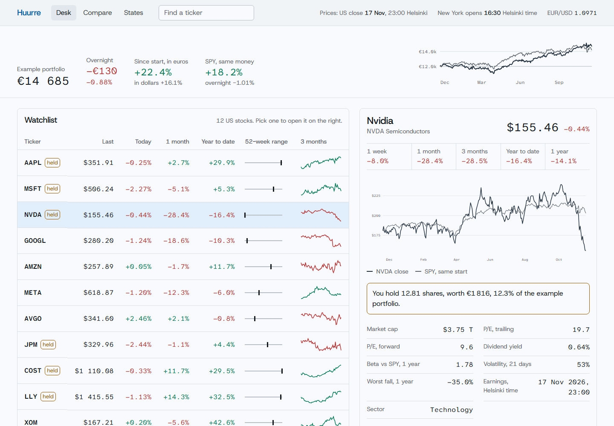

# Nordic Desk

A personal long-term stock research desk, shown in euros. A Python command-line tool turns locally cached market data into static HTML pages: a portfolio desk, impact what-ifs, single-stock analysis with a rules-based verdict, and a forecasts page that checks the desk's own signals against what happened afterwards.



> All numbers in the screenshots use an invented example portfolio. Nothing here is investment advice.

## What it does

- **Desk and Impact:** holdings, daily moves against SPY in euros, and what-ifs for new money with a tech-share cap.
- **Analysis:** one page per stock with price chart, toggleable indicators, hover explanations and a fixed-rule verdict (thresholds in `config/analysis.toml`).
- **Forecasts:** signal scorecard against SPY with overlap-corrected intervals, lump sum versus spreading a purchase, volatility-sized purchases, and analyst targets put into context.
- **Ideas:** discovery cards from a watchlist, fund look-through and news briefs.

## Principles

- Every number is computed in Python and covered by tests; the browser scripts only draw and format.
- No look-ahead in any backtest or rebuilt signal.
- Tests use invented prices only. Real holdings live in git-ignored local files and are never sent to outside services.

## Quick start

```bash
uv sync
uv run nordic-desk update      # price history and company facts (Yahoo)
uv run nordic-desk build       # needs config/holdings.local.toml (see config/holdings.example.toml)
uv run nordic-desk site        # pages in out/site
uv run nordic-desk serve       # http://127.0.0.1:8765
uv run pytest -q
```

## Stack

Python 3.12, pandas, numpy, scipy, statsmodels, arch. HTML is rendered in Python with a small design-token system. See `docs/superpowers/specs/` for the written design behind each feature.

## All commands

```bash
uv run nordic-desk update                      # full price history (re-adjusted for splits and dividends), daily open/high/low and company facts from Yahoo
uv run nordic-desk import-report <nordnet.pdf> # holdings into config/holdings.local.toml (git-ignored)
uv run nordic-desk build --record <export.csv> # out/desk.json and out/aamu.json
uv run nordic-desk ideas                       # cards for config/ideas.toml
uv run nordic-desk site                        # pages in out/site, incl. out/site/analysis/<ticker>.html per held, watched or Ideas stock
uv run nordic-desk serve                       # http://127.0.0.1:8765 with search in the Ideas page
uv run nordic-desk plan --amount 5000          # split new money over the ideas (tech cap in config/target.toml)
uv run nordic-desk alerts                      # stocks that crossed a buy or sell threshold
uv run nordic-desk lookthrough                 # largest companies once funds are opened up (Yahoo top holdings)
uv run nordic-desk serve --lan                 # also on the home Wi-Fi, behind a one-time key in the printed link
```

## Data and limits

Free daily data, not point-in-time. Forecasts are statistical estimates from past prices, not predictions.

## License

MIT, see `LICENSE`.
